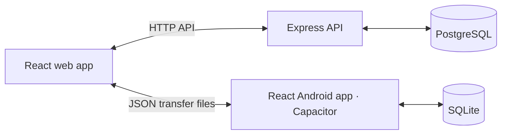

# Reading Tracker

Reading Tracker is a web app for logging books and rereads, organizing a personal
library with tags, and exploring reading habits through charts and a Year in
Review. An offline Android companion lets you log and edit readings away from
your computer.

## How it works



The web and Android apps share React and TypeScript UI. On the web, the Express
API uses Zod to validate requests and Drizzle to access PostgreSQL. The Android
app reads and writes its local SQLite library.

To start using the companion, import a library snapshot from the web app. When
you bring phone edits back, the web app previews the changes and lets you resolve
potential duplicates before saving. It then creates a refresh file that brings
the reviewed library back to the phone.

See the [client](docs/client.md), [server](docs/server.md), and
[Android](docs/android.md) guides for code maps and workflow details.

## Run locally

You’ll need Node.js 24, npm, and PostgreSQL. From the repository root, install
dependencies and copy the example server configuration.

```sh
npm ci
npm ci --prefix client
npm ci --prefix server
cp server/.env.example server/.env
```

Set a `SESSION_SECRET` of at least 32 characters in `server/.env`, then follow
[Initialize a new database](docs/server.md#initialize-a-new-database) to configure
PostgreSQL, apply the schema, and create your account. Start the app from the
repository root.

```sh
npm run dev
```

Open the local URL printed by Vite and sign in with the account you created.
For native builds and phone setup, see the [Android guide](docs/android.md).

## Verify

```sh
npm run check
```

This runs client lint, client and server unit tests, and builds the web app,
companion web bundle, and server. The [database integration tests](docs/server.md#tests)
run separately against a disposable PostgreSQL database and include a
PostgreSQL–SQLite transfer round trip.

## Portfolio demo

The static demo uses real books and fictional reading activity. The sample
catalog includes [The Guardian’s 100 best novels of all time](https://www.theguardian.com/books/ng-interactive/2026/may/12/the-100-best-novels-of-all-time)
and 25 nonfiction titles. It runs entirely in the browser with sample data.
See the [local preview and GitHub Pages steps](docs/client.md#portfolio-demo).
